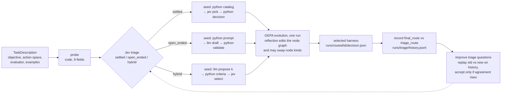
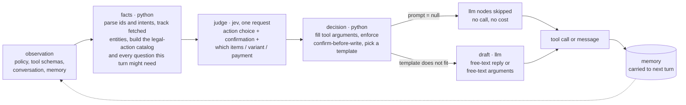
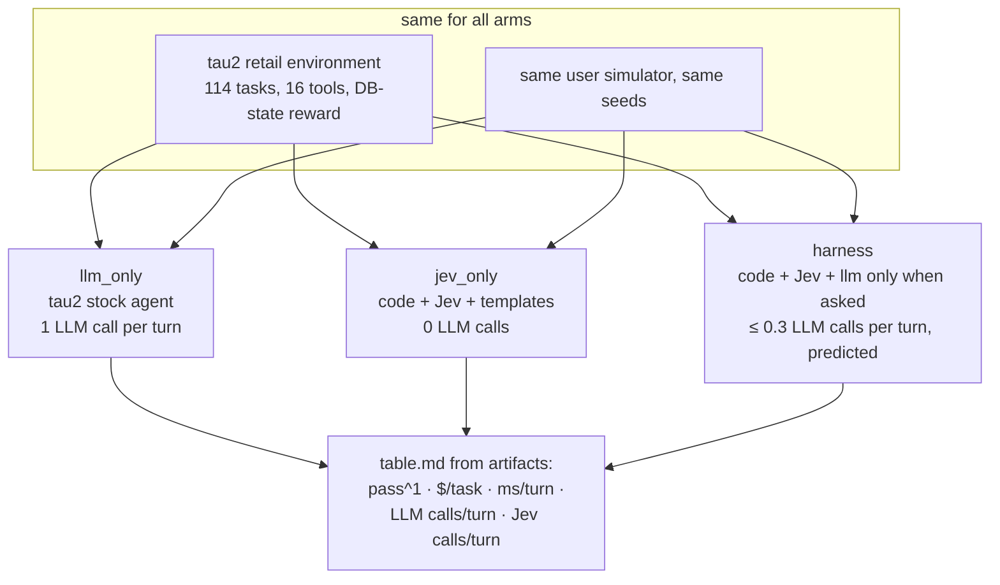

# mixed_harness

A routed decision harness: code computes the facts, a judgment model (TypeSafe's Jev) makes the bounded
choices, and a language model writes only the text that has to be generated. The split is not hand-written.
A triage step reads the task description and picks one of three harness shapes, and the existing GEPA
evolution from [JevHarness](https://github.com/TianyuCodings/JevHarness) (`auto_jev`) then edits the whole
node graph, node kinds included. After every run the triage criteria take one replay-validated improvement
step.

- Design: `docs/superpowers/specs/2026-09-22-routed-harness-level1-design.md`
- Routed harness reference: `docs/routed-harness.md`
- τ²-bench three-arm test: `docs/tau2.md` and `docs/superpowers/specs/2026-09-24-tau2-three-arm-design.md`
- Interactive diagram: https://claude.ai/artifact/PDRJpw5s2nNLd4opTtxqmA

## How a task becomes a harness

The probe is deterministic and free: declared action kind, label count, whether examples carry a legal-action
catalog, evaluator exactness, expected-output shape. Jev sees the probe evidence, the objective and five
clipped examples, and returns a probability over the three routes. A wrong triage is corrected inside
evolution rather than by re-running it: the summary reports both the seed route and what the selected
harness ended up as.

## What one decision looks like

The same three node kinds run inside every harness. The example below is the τ²-bench retail seed
(`examples/tau2/seeds.py`), one agent turn:

Every Jev question is asked in one request (adding questions barely changes its latency), and an llm node
whose prompt evaluates to `null` is skipped by the runtime. The turn's ledger records what actually ran:
python node count, Jev calls, LLM calls and skips, tokens, and the model ids the providers echoed.

## The τ²-bench test: three arms, one environment

The claim under test is not accuracy above the leaderboard. It is matched pass^1 against the same LLM used
alone, at a fraction of the cost and latency per turn, with the Jev-only arm showing where generation is
actually needed. Predictions, resolution and the decision table are written down before any run in the
design file. `docs/tau2.md` has the setup and the reading guide for the table.

## Setup

    uv sync --locked --extra dev
    uv run pytest

Functional Python nodes run under `bwrap` on Linux and `sandbox-exec` on macOS. Credentials go in a local
`.env` (see `.env.example`): `TYPESAFE_API_KEY` or `AI_GATEWAY_API_KEY` for Jev, `ANTHROPIC_API_KEY` for
llm nodes. `uv run auto-jev doctor` prints which are present.

## Routing

`auto_jev.routed.run_routed_evolution(task, train, validation, jev=..., llm=..., proposer=..., store=..., evaluator=..., task_id=...)`
probes the task, asks Jev for a route, seeds one harness from that route's template and runs the existing
evolution once. Pass `route=` to override the triage. See `docs/routed-harness.md`.

## Live run

    uv run python scripts/live_run.py --task classify --rounds 2 --train 6 --validation 6
    ~/tau2-bench/.venv/bin/python scripts/tau2_compare.py --domain retail --split base --num-tasks 5

## Repository map

| Path | What it holds |
|---|---|
| `auto_jev/` | spec validation, parallel runtime, Jev and LLM transports, triage, routed evolution, freezing |
| `examples/classify`, `examples/constrained_text` | bundled settled and open-ended tasks, run end-to-end under mock providers |
| `examples/tau2/` | tau2-bench adapter, the PipelineAgent wrapper, and the two seed harnesses |
| `scripts/` | `live_run.py` for a small real-model routed run; `tau2_compare.py` for the three-arm test |
| `docs/` | design files, the routed-harness reference, the tau2 guide |
