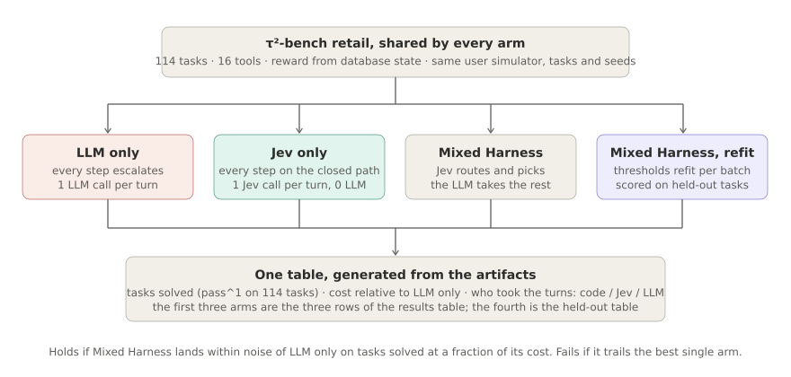

# Mixed Harness

An agent that serves customers, calls tools and follows a policy makes a decision on every turn. Most of
those decisions are small: which record to look up, which of four items the customer meant, whether they
just said yes. A standard LLM agent pays a full model call for each one, re-reading the policy, the tool
list and the whole conversation every time: about 8,300 input tokens and 2 seconds per turn on τ²-bench
retail. Some decisions are not small: an explanation the policy does not script, a plan across several tool
calls, a reply that has to be composed. For those, the full model call is the right tool.

Mixed Harness splits a tool-using task along that line with one table, and learns the table from its own
records. **For every type of state the table says who takes the step: code, Jev (TypeSafe's judgment model,
400 ms, typed output, a probability with every answer), or an LLM. Jev takes a step only when its
probability on its own pick clears the threshold the table holds for that state. Every step is recorded, and
after each run the table is recomputed: a state type moves to code when the LLM always did the same thing
there, to Jev when Jev's picks match the LLM's at some probability, and stays with the LLM otherwise.**

## Architecture

**Runtime, every step, no domain code in the picture.** Code lists the options the state allows: the tools
whose arguments can be filled, the known entities (orders, items, payment methods), the templates, and
"none of these". The table is looked up by state type. Code takes the step with no model call. Jev takes it
with one request, which also asks the candidate questions (which item, which variant, did the customer
confirm), and the pick executes when Jev's probability on it is at or above the threshold. Otherwise the LLM
takes the step in one native tool-calling turn. The guard checks tool names and arguments, lets no database write through
without the customer's yes to that operation, and falls back to the listed default when a model's output is
unusable. The step is written to the step table with the state type, who took it, the probability, the action
and later the episode's reward.

**Offline, after every run, the only place domain information enters.** Two products. The option-listing
code is written once by a language model from the tool schema, the policy and the patterns in the records,
then frozen and run as ordinary code; in the current version it is hand-written for retail. The table is
recomputed from the step table and the recorded LLM-only trajectories by three rules: a state type goes to
code when the LLM's action there is the same at least 90% of the time; to Jev, with threshold τ, when Jev's
picks at or above τ agree with the LLM's at least 90% of the time; to the LLM when no τ reaches that. Traffic
only moves toward the cheaper end, and the guard and the thresholds hold accuracy while it moves.

**Why Jev shapes the design.** Jev returns typed outputs only, so code or an LLM fills free text. Its
probability is calibrated: on 1,002 recorded closed steps it agreed with the LLM on 98% of picks at 0.99 or
above, 82% between 0.90 and 0.99, and 35% below 0.90, so the probability is the abstain signal. Asked instead
whether it could take a step, it was right 60% of the time; the table never asks that. It picks well when the
options are a judgment and poorly when the next step depends on a plan the conversation implies (44% in the
clusters right after a lookup), so those state types sit with the LLM until the records show otherwise.

## The table on retail

The current table has about thirty rows, all computed from 1,389 recorded LLM-only turns and 114 routed
episodes. A sample:

| state type | who | τ | basis |
|---|---|---|---|
| no customer message yet | code: greet | | LLM did the same on 114 of 114 |
| not authenticated, one name and a zip code | code: look the customer up | | 77 of 79 |
| not authenticated, otherwise | Jev | 0.6 | agreement 98%, n=168 |
| authenticated, customer names an order not yet loaded | code: load it | | 8 of 9 |
| authenticated, order loaded, return intent | Jev | 0.6 | agreement 100%, n=19 |
| authenticated, a lookup just returned, no order in focus | LLM | never | Jev at ≥ 0.9 agrees 52% to 71% |
| everything else | Jev | 0.9 | 92% at ≥ 0.9 |

Rules that read as natural but the records contradict were tried and removed: "report a result as soon as
it arrives" (the LLM does that 67% of the time), "load the profile after authentication" (23%: it asks which
order instead), "ask which order when several are known" (11%: it loads them). A row enters the table only
when the records agree with it.

## Measuring it

On τ²-bench retail (114 tasks, 16 tools, reward from the database state), the arms run every task against the
same simulated customer with the same seeds: LLM only (the benchmark's own agent), Jev only (every step on
the Jev path, nothing to the LLM), and the routed harness with the table. One table is generated from the
artifacts: pass^1, dollars per task, turns per task, and the share of steps taken by code, Jev and the LLM.
The decision rules, predictions and every result are in `docs/design/tau2-four-arms.md`.

| version | pass^1 | $ per task | turns | code | Jev | LLM |
|---|---|---|---|---|---|---|
| LLM only | 0.842 | 0.224 | 12.2 | 0 | 0 | 100% |
| Jev only | 0.158 | 0.003 | 15.4 | 0 | 100% | 0 |
| routed, one global threshold, a route question | 0.807 | 0.208 | 17.9 | 0 | 37% | 63% |
| routed, eight hand-written code rows | 0.658 | 0.144 | 19.3 | 39% | 25% | 36% |
| routed, the five code rows the records support (94 of 114 tasks) | 0.83 | | | | | |

Noise on pass^1 is ±7.3 points. The hand-written rows cost 15 points, the record-supported rows gave them
back; the last row's run stopped at task 94 when the account's credit ran out and finishes with the remaining
twenty. The cost half of the claim is open: the version within noise of the LLM costs 0.84× to 0.93× of it,
because the state types after a lookup still go to the LLM. The learning curve, run → recompute → run, has
not been drawn yet; it is the next experiment.

## Status

| Part | State |
|---|---|
| Runtime, sandbox, spec format; nodes skip on null input; malformed LLM replies are soft failures | done |
| Option listing for retail | done, hand-written (`examples/tau2/seeds.py`) |
| Option listing written by an LLM from schema and policy | not started |
| The table: code rows, Jev thresholds per state type, LLM rows | done, fitted from records (`scripts/fit_policy.py`, `examples/tau2/policy.json`); code rows validated by replay but applied by hand |
| One script that recomputes all three columns after a run | partial: thresholds and preferences, not yet the code rows |
| Runtime path: code → Jev by probability → LLM → guard | done (`mixedharness/`, routed seed) |
| Guard: tool and argument checks, write gate on every path, fallback | done |
| Step table and merge of partial runs | done (`mixedharness/trace.py`, `scripts/tau2_merge.py`) |
| Labeller and replay of Jev on recorded LLM-only turns | done (`scripts/stage0_label_replay.py`) |
| Learning curve over several rounds | not run |
| Second domain | not started |

## Quick start

    uv sync --locked --extra dev
    uv run pytest                                   # mock providers, no keys needed
    uv run mixedharness doctor                      # sandbox and credentials present

Credentials go in a local `.env` (see `.env.example`): `TYPESAFE_API_KEY` for Jev, `ANTHROPIC_API_KEY` for
the language model. Sandboxed Python nodes run under `bwrap` on Linux and `sandbox-exec` on macOS.

    ~/tau2-bench/.venv/bin/python scripts/stage0_label_replay.py                       # labels and Jev replay on recorded LLM-only traces
    ~/tau2-bench/.venv/bin/python scripts/fit_policy.py --replay runs/stage0/<stamp>/replay.jsonl --steps runs/tau2/<run>/routed/steps.jsonl
    ~/tau2-bench/.venv/bin/python scripts/tau2_compare.py --domain retail --split base --arms routed --policy examples/tau2/policy.json

## Layout

| Path | What it holds |
|---|---|
| `mixedharness/` | the package: spec, expressions, sandbox, runtime, Jev and LLM clients, router (table fitting), trace, mining, seeds, evolution, freeze |
| `examples/tau2/` | the τ²-bench adapter, the agent wrapper, the routed seed and its two controls, the fitted table, a replay user |
| `scripts/` | `stage0_label_replay.py`, `fit_policy.py`, `tau2_compare.py`, `tau2_merge.py`, `live_run.py` |
| `docs/design/` | `tau2-four-arms.md` (stages, predictions, every result), `implementation.md` |
| `docs/guides/` | `routed-harness.md` (reference), `tau2.md` (benchmark setup and how to read the table) |
| `docs/media/` | figures: `fig_general.svg`, `fig_measurement.svg` |

The execution layer follows [JevHarness](https://github.com/TianyuCodings/JevHarness), a harness as a graph of
sandboxed code and Jev calls evolved with GEPA, implemented independently here; JevHarness has no LLM at
runtime and authors its harness once, offline. GEPA is Agrawal et al., arXiv:2507.19457. τ²-bench is Barres
et al., arXiv:2506.07982.
