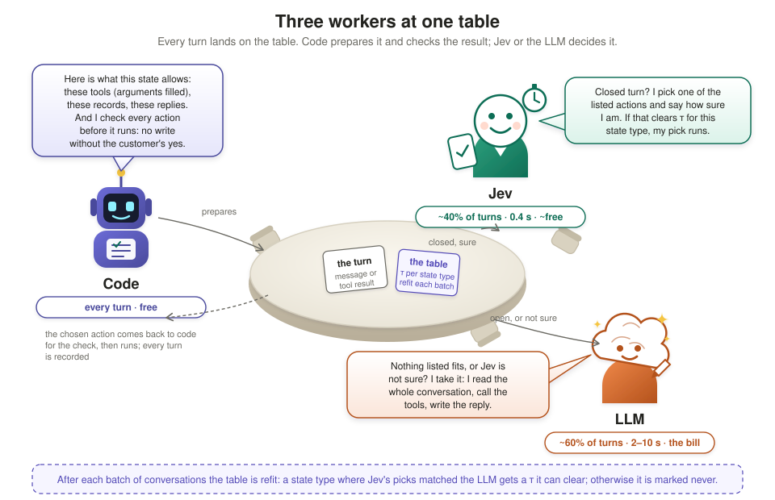
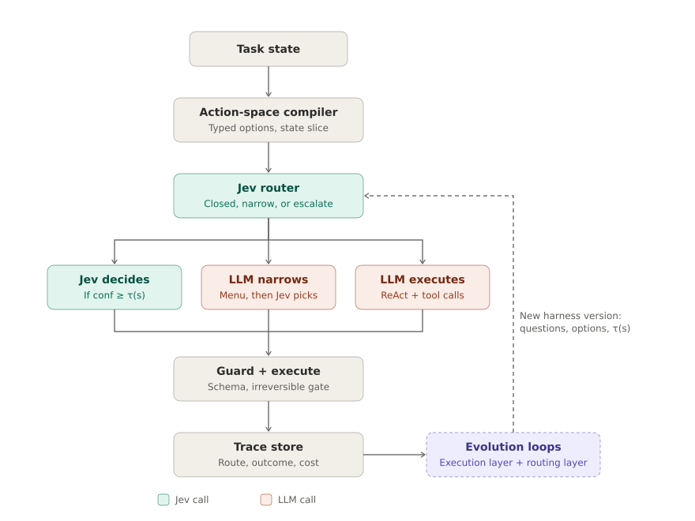
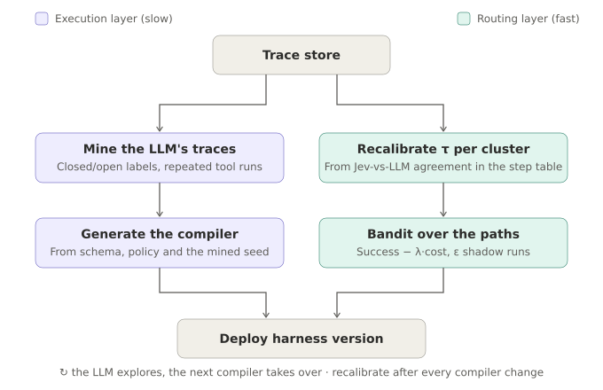

# Mixed Harness

<p align="center"><b>A harness for tool-using agents: code, a 400 ms judgment model and an LLM share the turns, and the split is learned from the harness's own records.</b></p>

<p align="center">


</p>

---

## ⚡ In one minute

- **What it is.** A harness, not an agent: the layer around the models that lists what a turn allows, decides
  who answers it (code, Jev or the LLM), checks the answer, records it, and learns the split. Put around a
  task's tools and policy, the harness with Jev and an LLM is the agent that gets measured.
- **The problem.** A customer-service agent decides something on every turn. Most decisions are small (which
  record, which item, did they say yes). An LLM agent pays a full model call for each one: ~8,300 tokens and
  2 seconds per turn on τ²-bench retail.
- **The idea.** Code lists what the current state allows. **Jev**, TypeSafe's judgment model (400 ms, a
  probability with every answer), picks among the listed actions. The pick is used when its probability
  clears a threshold for that type of state; otherwise the **LLM** takes the turn. Every turn is recorded.
- **The learning.** After every batch of conversations the thresholds are refit from where Jev's picks
  matched the LLM's. No hand-tuned router: a table of thresholds, read off the records.
- **Measure before you build.** `mixedharness audit` takes a recorded trace of any tool-using agent and
  reports how many of its turns a judge would take, how often the judge's pick matches what the agent did,
  and what the trace would have cost. On the retail traces: at a threshold of 0.90, 56% of turns, 95%
  agreement, half the cost.
- **The judge is a setting.** Jev is the judge the numbers below were measured with; `--judge` points the
  same harness at any model served with log-probabilities (vLLM, llama.cpp, or the bundled server over a
  transformers model), so it runs with a TypeSafe key or with none. One open model is measured so far:
  Qwen3-4B, calibrated, is right on 99% of the turns it is sure of but sure of only 20% of them, and its
  threshold table hands over half as many turns as Jev's on the same replay.
- **The result.** On τ²-bench retail: 0.781 of tasks solved against the LLM-only agent's 0.807 (within noise)
  at **0.74× its cost**; on conversations it has never seen, cost settles near 0.75× after 150 conversations.
  A variant that also learns code rows reaches **0.62×** and keeps falling.



---

## 🎁 What it gives you

Measured on τ²-bench retail (114 customer-service tasks, the same simulated customer for every system; every
number is explained in the sections below and recorded in `docs/design/tau2-four-arms.md`).

| Advantage | What was measured | Number |
|---|---|---|
| **Cheaper than an LLM agent, same tasks solved** | cost per task relative to the benchmark's own LLM agent, and tasks solved | main harness: 0.74× the cost at 0.781 against the LLM's 0.807 (within noise); the code-row variant: 0.62× at 0.789 |
| **It gets cheaper the more it is used, on conversations it has never seen** | 76 tasks served per pass, the table refit after each pass, 38 never-seen tasks scored each time | main harness: 0.80× → 0.75× over the first 152 conversations, then flat; the code-row variant: 0.75× → 0.60× over 304 conversations, accuracy unchanged |
| **Nothing in the routing is hand-tuned** | where the thresholds come from | every threshold is the lowest value at which Jev's recorded picks matched the LLM's at least 90% of the time; state types where no threshold reaches that are marked never |
| **Every decision is inspectable** | what a turn leaves behind | the state type, who took the turn and why, Jev's probability, the action, and later the episode's outcome; the table is a short list a person can read |
| **The LLM stays in the loop for what needs it** | which turns the LLM still takes | open requests, plans across several tool calls, composed replies; about 60% of turns on retail for the main harness, 50% for the variant |
| **Jev is cheap and fast where it is trusted** | Jev's share and its agreement with the LLM | 40% of turns; on accepted picks 92% to 98% agreement, 0.4 s per turn, about one hundredth of an LLM call |
| **You can measure your own agent before adopting anything** | `mixedharness audit` on a recorded trace: the share of turns a judge would take at each threshold, its agreement with the agent's recorded action, the trace re-priced | 114 retail conversations of the gpt-5.5 agent: at τ = 0.90, 56% of turns, 95% agreement, 0.50× the cost; at 0.99, 29%, 99%, 0.79× |
| **Not locked to one judge** | the same harness with another judge behind the `jev` nodes | `--judge logprob:<model>@<url>` for any model served with log-probabilities; the threshold table is fitted per judge, with a kill test on its probabilities. Qwen3-4B on the same replay as Jev: passes the kill test (99% agreement in its top bin, 20% of closed turns), hands over 30% of closed turns where Jev hands over 57%, and the audit with it reads 47% / 58% / 0.57× at τ = 0.90 (`docs/guides/judges-and-audit.md`) |

> Not yet shown: accuracy parity with a confidence interval (one seed per point, 9 points of noise on 114
> tasks), a second domain, and cost on a real bill rather than list-price tokens.

---

## 🧭 How it works



**At runtime, every turn goes through five stations:**

1. **Compiler (code).** Reads the conversation, remembers what it has fetched, keeps the customer's request
   list (asked for, minus done), and lists the actions the state allows: tools whose arguments can be filled,
   known entities (orders, items, payment methods), templated replies.
2. **Jev router (one request).** Jev answers three things at once: is this turn *closed* (one listed action is
   right) or does it go to the LLM; which listed action; and the candidate questions (which order, which
   variant, did the customer confirm).
3. **Who takes the turn.** Jev, when it said closed and its probability on the pick is at or above the
   threshold τ for this type of state. The LLM, otherwise, in one native tool-calling turn. A turn whose
   listed actions cannot cover the request goes to the LLM without asking. (The optional menu path, where the
   LLM writes a short menu and Jev picks, is off: it cost more than it saved.)
4. **Guard.** Checks tool names and arguments, lets no database write through without the customer's yes to
   that operation, falls back to the listed default when a model's output is unusable.
5. **Trace store.** The turn is recorded: state type, who took it and why, Jev's probability, the action, and
   later the episode's outcome.



**After every batch of conversations, two loops read the trace store:**

- **Fast loop: recalibrate τ per state type.** For every turn the LLM took, the record holds Jev's own pick and
  probability next to what the LLM did. A state type gets the lowest τ at which Jev's picks at or above τ
  agreed with the LLM at least 90% of the time; where no τ reaches that, the type is marked *never*.
- **Slow loop: regenerate the compiler** from the tool schema, the policy document and the patterns in the
  records. In the current version the compiler is hand-written for retail, and the patterns the records
  surfaced (the request list, two tools missing from the catalog) were applied by hand.

**Why Jev shapes the design.** Jev returns typed outputs only, so code or an LLM fills free text. Its
probability is calibrated: on 1,002 recorded closed turns it agreed with the LLM on 98% of picks at 0.99 or
above, 82% between 0.90 and 0.99, and 35% below 0.90, so the probability is what the threshold reads. Its
route answer separates closed from open turns (85% of its "closed" calls are closed) but does not say whether
its pick is right (52% on those turns), which is why the threshold sits on the pick, not on the route answer.
It picks well when the options are a judgment and poorly when the next turn depends on a plan the
conversation implies (44% in the state types right after a lookup), so those types are marked never until the
records show otherwise.

---

## 📋 The table on retail

One threshold per state type, computed from 1,389 recorded LLM-only turns and refit from every batch of
routed conversations since. A state type is: the authentication state, whether a customer message or a tool
result just arrived, the status of the order in focus, and the intent. A sample:

| state type | τ | basis |
|---|---|---|
| not authenticated, customer message | 0.6 | Jev agrees with the LLM on 98% of picks at ≥ 0.6, n = 168 |
| authenticated, order delivered, return intent | 0.6 | 100% at ≥ 0.6, n = 19 |
| authenticated, a lookup just returned, no order in focus | never | 52% to 71% even at ≥ 0.9 |
| authenticated, order pending, cancel intent, customer message | 0.6 | after refit from 304 routed conversations |
| everything else | 0.9 | 92% at ≥ 0.9 |

After 304 routed conversations the table holds 38 thresholds, 18 of them never. Refitting moves turns between
Jev and the LLM; it does not move turns to code, which is the difference between this harness and the
code-row variant at the end of the results.

**What Jev is for.** The turns where the actions are listed and the arguments are known but a judgment
remains: which record to load next, which variant the customer means, which payment method, whether the
reply is a yes. About 40% of all turns; the LLM takes about 60% and nearly all of the cost. Jev is not trusted
on its own say-so: its route answer is one signal, its probability on the pick is the one that gates.

---

## 📊 Results


The four arms in the figure are the two tables below: **LLM only**, **Jev only** and **Mixed Harness** are the
three rows of the results table; **Mixed Harness, refit**, the same harness with its thresholds refit from
every batch served and scored on tasks it never saw, is the held-out table that follows.

The benchmark is **τ²-bench retail**: 114 customer-service conversations (returns, exchanges, cancellations,
address changes) with 16 tools and a simulated customer. A task counts as solved when the database ends in
the right state and the required things were said. Every system below runs the same 114 tasks against the
same simulated customer (gpt-5.5) with the same seed. Decision rules, predictions and every result:
`docs/design/tau2-four-arms.md`.

**How to read the tables**

- **tasks solved**: the fraction of the 114 tasks solved (pass^1); the refit row is scored on the 38 held-out
  tasks only, so its column is the held-out fraction. Running the same system twice moves this by up to 9
  points, so smaller differences are noise.
- **cost**: what the agent spent on model calls, relative to the LLM-only agent (1.00×). Jev costs about one
  hundredth of an LLM call, so this column is almost entirely LLM calls.
- **who took the turns**: the share of turns decided by code (no model call), by Jev, and by the LLM.

| system | tasks solved | cost | who took the turns: code / Jev / LLM |
|---|---|---|---|
| **LLM only**: the benchmark's standard agent, every turn is an LLM call | 0.807 | 1.00× | 0 / 0 / 100% |
| **Jev only**: every turn is a Jev pick, no LLM at all | 0.167 | 0.01× | 0 / 100% / 0 |
| **Mixed Harness**: Jev routes and picks, the LLM takes the rest | 0.781 | 0.74× | 0 / 42% / 58% |
| **Mixed Harness, refit**: the same harness with its thresholds refit from every batch served, scored on the 38 held-out tasks it never saw after 304 conversations (LLM only on those 38: 0.921) | 0.895 | 0.76× | 0 / 40% / 60% |

### 🔁 On conversations it has never seen

The 114 tasks are split once into a **stream** of 76 tasks the table learns from and **38 held-out tasks it
never sees**. Each pass serves the 76 stream tasks with a new simulated customer, refits the thresholds from
everything served so far, and scores the held-out 38 with that table. The LLM-only agent scores 0.921 on the
held-out 38 (noise on 38 tasks is wider than 9 points).

| conversations served | held-out tasks solved | held-out cost | held-out turns: Jev / LLM | thresholds (never) |
|---|---|---|---|---|
| 76 | 0.816 | 0.80× | 37% / 63% | 21 (9) |
| 152 | 0.816 | 0.75× | 43% / 57% | 29 (15) |
| 228 | 0.842 | 0.73× | 41% / 59% | 35 (18) |
| 304 | 0.895 | 0.76× | 40% / 60% | 38 (18) |

Accuracy stays within noise of the LLM's; the first refit buys 5 cost points and the curve then settles,
because refitting thresholds only moves turns between Jev and the LLM. `scripts/long_run.py --tau-only` runs
the protocol.

### 🧪 A variant that keeps lowering cost

`examples/tau2/seeds_splits.py` adds a second kind of table row: a state type, plus one or two cheap state
features, that the records show the LLM always handles the same way becomes a **code row** and is taken with no
model call. Under the same protocol its held-out cost falls **0.75× → 0.66× → 0.62× → 0.60×** at the same
accuracy, with 25% of turns on code by the last pass; on all 114 tasks it solves 0.789 at 0.62×. It is the
better number and the more complex harness; the figures above describe the main one.

---

## 🧩 Status

| Part | State |
|---|---|
| Runtime, sandbox, spec format; nodes skip on null input; malformed LLM replies are soft failures | done |
| Option listing for retail | done, hand-written (`examples/tau2/seeds.py`); the request list and the full write-tool catalog came from the records |
| Option listing written by an LLM from schema and policy | not started |
| The table: one threshold per state type, never rows; refit from the replay and from every recorded batch | done (`scripts/fit_policy.py --tau-only --ledger-replay`, `examples/tau2/policy.json`) |
| Runtime path: route question → Jev pick by probability → LLM → guard | done (`mixedharness/`, routed seed) |
| Guard: tool and argument checks, write gate on every path, fallback | done |
| Step table, ledgers, merge of partial runs | done (`mixedharness/trace.py`, `scripts/tau2_merge.py`) |
| Labeller and replay of Jev on recorded LLM-only turns | done (`scripts/stage0_label_replay.py`) |
| Learning curve on unseen conversations | done, 4 passes (`scripts/long_run.py --tau-only`) |
| The code-row variant (`seeds_splits.py`, `scripts/learn_splits.py`) | done, measured; not the main harness |
| LLM roles on a ChatGPT subscription instead of an API | done (`scripts/cli_proxy.py`, `--llm-backend codex`) |
| The judge as a setting: Jev, or any model served with log-probabilities; calibration and kill test per judge | done (`mixedharness/judge.py`, `scripts/judge_server.py`, `scripts/calibrate_judge.py`, `--judge`) |
| The ruler: audit a recorded trace of any agent before building | done (`mixedharness audit`, `mixedharness/audit.py`) |
| Second domain | not started |

## 🔌 Install in Claude Code

Inside Claude Code:

```text
/plugin marketplace add https://github.com/ShirleyHuang11/mixed_harness.git
/plugin install mixed-harness@mixedharness
/reload-plugins
```

Then describe your task (the tools, the policy, how an episode is scored) and invoke the `mixed-harness`
skill: it establishes the task contract, writes the option lister for your tools from the retail one, runs
stage 0 and the three arms, and fits the thresholds. The skill is `skills/mixed-harness/SKILL.md`; it works
the same way as a plain document for Codex or any other coding agent.

## 🔑 Requirements

Three things: Python, a judge, an LLM.

| You need | What for | Notes |
|---|---|---|
| **Python 3.11+** with [`uv`](https://docs.astral.sh/uv/) | the package | `uv sync --locked --extra dev`; the tests run on mock providers with no keys |
| **A judge**: `TYPESAFE_API_KEY`, or a model served with log-probabilities | the picks on closed turns | Jev from [console.typesafe.ai](https://console.typesafe.ai/keys): direct API, about $0.04 per million tokens, ~400 ms per request. Or `--judge logprob:<model>@<url>` against vLLM, llama.cpp, or `scripts/judge_server.py` over any transformers model: no key. Measured so far: Qwen3-4B, a weaker judge than Jev (the guide has the table) |
| **An LLM**: `ANTHROPIC_API_KEY`, or a Codex CLI subscription | the turns the LLM takes, and the LLM-only baseline | with a subscription, `--llm-backend codex` sends every LLM role through `scripts/cli_proxy.py`: no key, no bill |

Keys go in a local `.env` (copy `.env.example`); `.env` is ignored by git. With a local judge and a Codex
subscription the harness runs with no key at all.

Optional:

- **A native sandbox** for the code nodes: `bwrap` on Linux or `sandbox-exec` on macOS, used when present
  (`uv run mixedharness doctor` says which). Without one the code nodes run in a plain isolated worker under the
  same source allow-list. The native sandbox matters when an authoring model writes node code (the evolution
  loop); for the shipped harness it is a nicety. `MIXEDHARNESS_SANDBOX=require` insists on one.
- **[tau2-bench](https://github.com/sierra-research/tau2-bench)**, only to reproduce the numbers in this README
  (`docs/guides/tau2.md`). Your own task needs your own tools, policy and scorer, not the benchmark.

## 🚀 Quick start

**Use the package** (no keys needed for the tests):

```bash
uv sync --locked --extra dev
uv run pytest                      # mock providers
uv run mixedharness doctor         # which keys it found, and whether a native sandbox is present
```

**Measure your own agent first** (a recorded trace and a judge; nothing else):

```bash
uv run mixedharness audit examples/audit/traces.jsonl --format messages --judge jev --price-model gpt-5.5
#   traces.jsonl: one OpenAI-style conversation per line, {"id", "tools": [...], "messages": [...]}; the example file shows the shape
#   --judge logprob:Qwen/Qwen3-4B@http://127.0.0.1:8790/v1 after `python scripts/judge_server.py --model Qwen/Qwen3-4B`
```

It prints, per threshold, the share of turns the judge would take, how often its pick matches what the agent
did, and the trace re-priced with the LLM on the remaining turns. If the 0.90 row is small, stop here; the
harness has nothing to move.

**Measure on τ²-bench** (needs the keys from Requirements and a tau2-bench venv, see `docs/guides/tau2.md`):

```bash
PY=~/tau2-bench/.venv/bin/python
$PY scripts/tau2_compare.py --domain retail --split base --arms llm_only            # 1. the LLM-only baseline, recorded
$PY scripts/stage0_label_replay.py                                                   # 2. label its turns, replay Jev on them
$PY scripts/fit_policy.py --tau-only --replay runs/stage0/<stamp>/replay.jsonl \
    --out examples/tau2/policy.json                                                  # 3. one threshold per state type
$PY scripts/tau2_compare.py --domain retail --split base --arms jev_only,routed \
    --policy examples/tau2/policy.json                                               # 4. the two other arms, one table
$PY scripts/long_run.py --passes 4 --tau-only --replay runs/stage0/<stamp>/replay.jsonl \
    --llm-only-run runs/tau2/<llm_only run>                                          # 5. learn on a stream, score held-out tasks
```

Add `--llm-backend codex --proxy-base http://127.0.0.1:8765/v1` to run every LLM role on a Codex subscription
(start `scripts/cli_proxy.py` first). Add `--judge logprob:<model>@<url>` to steps 2 to 5 to run them on a
local judge instead of Jev (`docs/guides/judges-and-audit.md` has the calibration step that goes between 2 and
3). Every run writes its results, ledgers, step table and summary under `runs/<stamp>/`.

## 🗂 Layout

| Path | What it holds |
|---|---|
| `mixedharness/` | the package: spec, expressions, sandbox, runtime, Jev and LLM clients, the judge setting (`judge.py`), the trace audit (`audit.py`), router (table fitting), trace, mining, seeds, evolution, freeze |
| `examples/audit/` | `traces.jsonl`, two conversations in the messages format the audit reads |
| `examples/tau2/` | the τ²-bench adapter, the wrapper that presents the harness to the benchmark as its agent, the routed seed (`seeds.py`) and its two controls, the fitted thresholds (`policy.json`), the code-row variant (`seeds_splits.py`), a replay user |
| `scripts/` | `stage0_label_replay.py`, `fit_policy.py`, `learn_splits.py`, `tau2_compare.py`, `tau2_merge.py`, `learning_curve.py`, `long_run.py`, `cli_proxy.py`, `judge_server.py`, `calibrate_judge.py` |
| `docs/design/` | `tau2-four-arms.md` (stages, predictions, every result), `judge-and-audit.md` (the pluggable judge and the audit: predictions and results), `implementation.md` |
| `docs/guides/` | `routed-harness.md` (reference), `tau2.md` (benchmark setup and how to read the table), `judges-and-audit.md` (choosing a judge, calibrating it, auditing your own traces) |
| `docs/media/` | figures: `fig_who_takes_the_turn.svg`, `fig_runtime_path.svg`, `fig_evolution_loops.svg`, `fig_measurement.svg` |
| `skills/mixed-harness/` | the Claude Code skill: how to build and measure a harness for a new task, with an integration reference |
| `.claude-plugin/` | plugin and marketplace manifests for `/plugin install` |

The execution layer follows [JevHarness](https://github.com/TianyuCodings/JevHarness), a harness as a graph of
sandboxed code and Jev calls evolved with GEPA, implemented independently here; JevHarness has no LLM at
runtime and authors its harness once, offline. GEPA is Agrawal et al., arXiv:2507.19457. τ²-bench is Barres
et al., arXiv:2506.07982.
