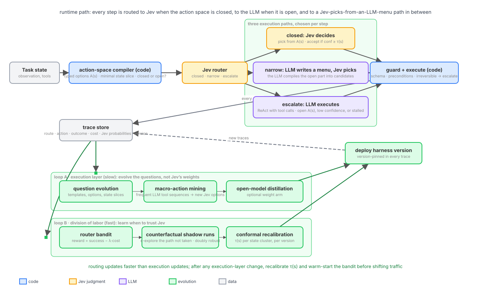
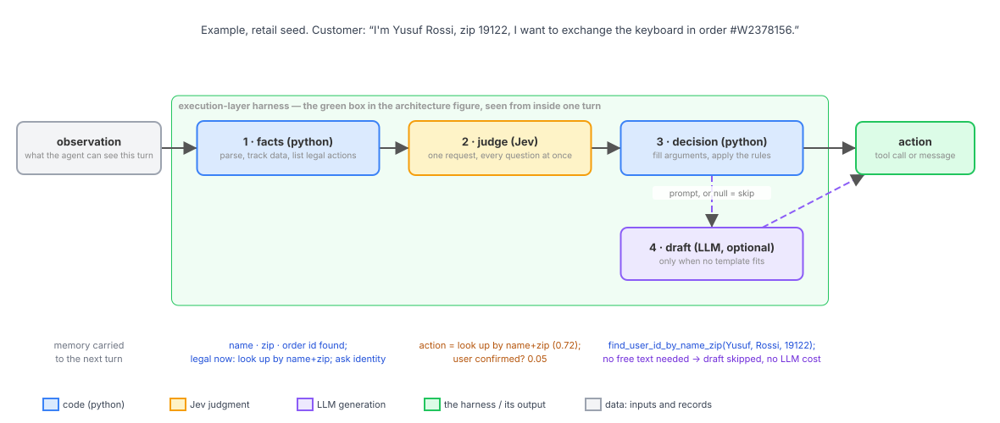
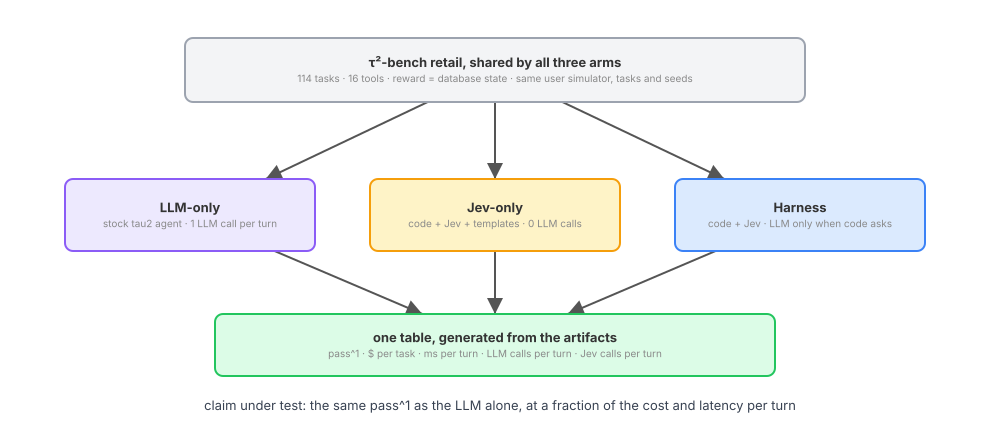

# Mixed Harness

An agent that serves customers, calls tools and follows a policy makes a decision on every turn. Most of
those decisions are small: which record to look up, which of four items the customer meant, whether they
just said yes. A standard LLM agent pays a full model call for each one, re-reading the policy, the tool
list and the whole conversation every time. On τ²-bench retail that is about 8,500 input tokens and 2
seconds per turn (measured on 2 tasks, see below). Some decisions are not small: an explanation the policy
does not script, a plan across several tool calls, a reply that has to be composed. For those, the full
model call is the right tool.

Mixed Harness starts from that difference. **Every step is routed: to Jev, TypeSafe's judgment model, when the
action space is closed; to a language model when it is open; and to a middle path where the language model
writes a short menu and Jev picks from it.** Which path a step takes is a decision the system makes, records,
and learns from, and the division of labor between Jev and the LLM moves over time as traces accumulate.

- **Closed path: Jev decides.** Code compiles the state into a typed action set, the facts that matter and a
  minimal state slice. Jev picks from that set in one request and returns calibrated probabilities. The
  pick is accepted when its confidence clears a per-cluster threshold; a small LLM call fills a free-text
  argument when one is needed. Cost: about one Jev call.
- **Narrow path: the LLM writes a menu, Jev picks.** For an open subproblem the LLM does not act; it
  compiles the open part into a few candidate actions and Jev chooses among them. Often the most useful
  mode in practice.
- **Escalate path: the LLM executes.** A full ReAct turn with tool calls, for open action spaces, low
  confidence, or a trajectory that has stalled.

A guard runs on every path: schema validation, precondition checks, and a hard escalation for irreversible
actions regardless of confidence. Every step is logged to a trace store with its route, action, outcome,
cost, Jev probabilities and harness version.

## Architecture

**Why Jev shapes the design.** Jev returns only typed outputs, booleans, rubric scores and multiple-choice
picks, so Jev picks actions and free-text arguments need a small LLM slot filler. It is single-pass,
non-autoregressive and returns calibrated confidence, so an accept threshold is cheap to set and can be
recalibrated per domain with conformal prediction. Extraneous context lowers its accuracy and its context is
capped, so the compiler must produce a minimal state slice per question, and slice selection is something
to evolve. Its weights are proprietary, so the questions evolve, not the model; an open decision model can
run as an optional weight arm. It is weaker on long horizons, so per-step confidence overstates trajectory
reliability and the router adds trajectory-level escalation.

**Runtime path.** The action-space compiler turns tool schemas and the current state into a typed action
set A(s), flags it as closed or open, and emits the minimal state slice for each Jev question. The Jev
router asks one choice question per state, closed, narrow or escalate, at the cost of about one Jev call.
Each path produces an action. The guard checks it, then it executes and is logged. Trajectory-level escalation
forces the LLM path after k consecutive low-margin steps or when progress stalls.

**Loop A, execution layer (slow).** Evolve the questions, not Jev's weights: question templates, option
sets, rubric definitions and state-slice selection are treated as programs and optimized on traces with
fitness = outcome reward minus calibration error. Macro-action mining promotes frequent LLM tool-call
subsequences to new options in Jev's choice set, so open territory becomes closed territory over time: the
LLM explores, Jev compiles and exploits. An optional weight arm distills LLM escalations into an open
decision model. On the LLM side, prompts and tool docs evolve on failed traces; weights stay frozen.

**Loop B, division of labor (fast).** The router is a contextual bandit over the three paths. Its reward is
success minus λ·latency minus λ·tokens, weighted on multi-step success rather than per-step accuracy, and
sweeping λ traces the Pareto frontier. Counterfactual shadow runs execute the path not taken with probability ε and use doubly robust
off-policy estimates, otherwise Jev only sees states the router already trusts it with and its traffic
share cannot grow. Conformal recalibration sets τ(s) per state cluster so the error rate on accepted Jev
decisions stays below α, and is redone after every harness version.

**Coupling.** Routing updates faster than execution updates. After any execution-layer change, recalibrate
τ(s) and warm-start the bandit before shifting traffic, or the router optimizes against a Jev that no
longer exists. Every component is version-pinned in the traces.

**Metrics that show the harness is evolving rather than tuning.**

- Jev traffic share over time.
- Escalation precision: how often the LLM disagreed with Jev's top choice on escalated states.
- Error rate on accepted Jev decisions, against α.
- The success versus cost and latency frontier.
- Trajectory-level completion rate by route mix.

## The same step on the three paths

The customer writes: "I'm Yusuf Rossi, zip 19122, I want to exchange the keyboard in order #W2378156."
The compiler finds a name, a zip code and an order id and lists the actions that are legal right now; the
action set is closed (look the customer up, or ask for identification), so the router sends the step down
the closed path. Jev picks the lookup with confidence 0.72, above τ for this cluster, no argument is free
text, the guard accepts the call, and `find_user_id_by_name_zip(Yusuf, Rossi, 19122)` executes. Cost: one
Jev call.

Three turns later the customer asks for the specifications of the replacement items. The action set is
open, so the router does not send the step to Jev alone. On the narrow path the LLM writes a short menu
(quote the two variants, ask which matters more, offer to list all) and Jev picks one. On the escalate path
the LLM answers in a full turn with tool calls. Which of the two the router chooses is what loop B learns
from traces; which turns stop needing the LLM at all is what loop A's macro-action mining changes over time.

| | closed | narrow | escalate |
|---|---|---|---|
| who decides | Jev, from the compiled action set | Jev, from a menu the LLM wrote | the LLM |
| who writes | a small LLM slot filler, only for free-text arguments | the LLM, a few candidates | the LLM |
| cost per step | about one Jev call | one short LLM call and one Jev call | one full LLM call |
| guard | schema, preconditions, irreversible → escalate | same | same |

## Measuring it

The claim is about the dispatch, so the test scores the routes and the dispatcher on the same terms. On
τ²-bench retail (114 tasks, 16 tools, reward computed from the database state), every route runs every task
against the same simulated user with the same seeds: the Jev route, the LLM route, and the evolved Jev route.
The best of the three on each task is the oracle. The fourth row is the triage's own pick. One table is
generated from the artifacts: pass^1, dollars per task, milliseconds per turn, and LLM and Jev calls per
turn, for each route, for the oracle, and for the dispatcher. The claim holds if the dispatcher lands within
noise of the oracle's accuracy at a fraction of the LLM route's cost; it fails if the dispatcher trails the
best single route. Predictions and the decision table are written down before any run in
`docs/design/tau2-three-arms.md`; `docs/guides/tau2.md` covers setup and reading.

Measured so far, on 2 retail tasks (the run stopped when the language-model account ran out of credit):
the LLM route passed 2 of 2 at $0.17 per task and 2.1 s per turn; the Jev route passed 0 of 2 at $0.004 per
task and 0.47 s per turn, with one Jev request per turn and no LLM calls; the hand-written evolved shape
(the Jev route plus a hand-to-LLM step) passed 1 of 2 with 0.33 LLM calls per turn. Two tasks say nothing about accuracy (±35 points); they do say the instrument
counts what it should, and that Jev answers in about 400 ms.

## Status

| Part | State |
|---|---|
| Runtime, sandbox, expression language, spec format | done, tested on mock providers |
| Closed path: compiler, Jev pick, code decision (the τ²-bench Jev-route seed) | done, run against real Jev |
| Escalate path: `agent` node, one native tool-calling turn | done |
| Guard: schema and argument checks, confirm-before-write in code | done in the seed's decision node; irreversible-action escalation not yet |
| Trace store: trajectories, rewards, route chosen vs realised | done (`mixedharness/store.py`, `triage_store`) |
| Loop A, question evolution (GEPA over the whole spec) | done, tested with a mock reflection model |
| Per-step Jev router with closed / narrow / escalate | not yet: today the dispatch is once per task, and the hand-to-LLM option is a catalog entry |
| Narrow path (LLM menu, Jev picks) | not yet |
| Trajectory-level escalation | partial: the seed transfers after three identical replies |
| Loop A, macro-action mining and the weight arm | not yet |
| Loop B: router bandit, shadow runs, conformal τ(s) | not yet |
| Dispatcher row and oracle in the benchmark table | not yet: the runner scores the routes as arms |

## Quick start

    uv sync --locked --extra dev
    uv run pytest                                   # mock providers, no keys needed
    uv run mixedharness doctor                      # sandbox and credentials present

Credentials go in a local `.env` (see `.env.example`): `TYPESAFE_API_KEY` for Jev, `ANTHROPIC_API_KEY` for
the language model. Sandboxed Python nodes run under `bwrap` on Linux and `sandbox-exec` on macOS.

    uv run python scripts/live_run.py --task classify --rounds 2 --train 6 --validation 6
    ~/tau2-bench/.venv/bin/python scripts/tau2_compare.py --domain retail --split base --num-tasks 5

## Layout

| Path | What it holds |
|---|---|
| `mixedharness/` | the package: spec, expressions, sandbox, runtime, Jev and LLM clients, evolution, triage, routing, freeze |
| `examples/classify`, `examples/constrained_text` | a settled and an open-ended task that run end-to-end on mock providers |
| `examples/tau2/` | the τ²-bench adapter, the agent wrapper, and the route seeds |
| `scripts/` | `live_run.py` (small real-model routed run), `tau2_compare.py` (the benchmark test) |
| `docs/design/` | `routing.md`, `tau2-three-arms.md` (predictions and decision table), `implementation.md` |
| `docs/guides/` | `routed-harness.md` (reference), `tau2.md` (benchmark setup and how to read the table) |
| `docs/media/` | figures and the JSON specs they are rendered from |

The execution layer follows the design of [JevHarness](https://github.com/TianyuCodings/JevHarness), a
harness as a graph of sandboxed code and Jev calls evolved with GEPA, implemented independently here. GEPA
is the optimizer of Agrawal et al., arXiv:2507.19457. Figures are rendered from the specs in
`docs/media/specs/`; edit the spec, not the SVG.
