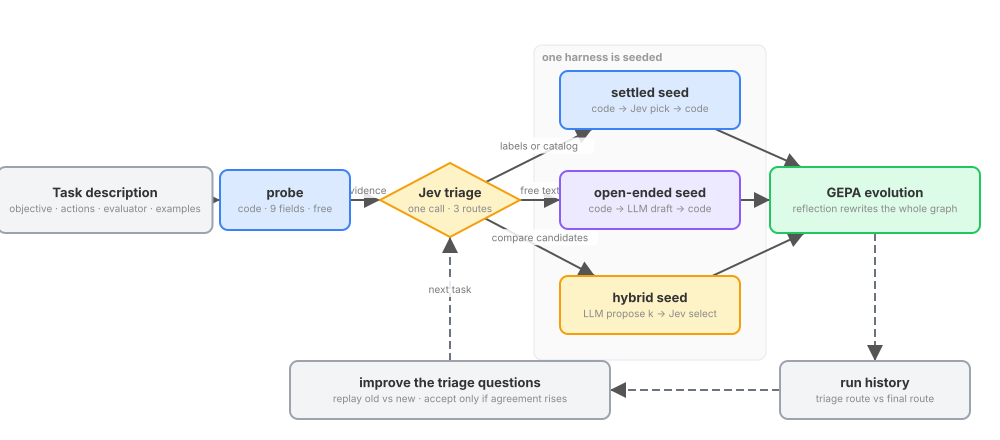

# mixed_harness

**Code computes the facts. A judgment model makes the bounded choices. A language model writes only the
text that has to be written.** This repository turns a task description into such a harness automatically,
evolves it with GEPA, and measures what each part costs.

The code is a fork of [JevHarness](https://github.com/TianyuCodings/JevHarness) (`auto_jev`), which pairs
TypeSafe's judgment model [Jev](https://docs.typesafe.ai) with an LLM-authored decision pipeline. The fork
adds three things: a triage step that picks the harness shape, `llm` nodes for generation, and a
three-arm benchmark test on τ²-bench.

## 1. From task to harness

A task description (objective, action space, evaluator, a few examples) goes through a free, deterministic
probe. Jev reads the probe's nine fields and the examples and returns a probability over three routes:
**settled** (pick from a finite set), **open-ended** (generate free text checked by code), or **hybrid**
(generate a few candidates, then pick). One harness is seeded from that route's template and GEPA evolves it
once; the reflection model may rewrite the node graph, node kinds included, so a wrong triage is corrected
inside the run. After each run the triage questions get one replay-validated improvement: a proposed
question map is accepted only if it agrees with the recorded outcomes more often than the current one.

## 2. One decision inside a harness

Every harness is a small graph of three node kinds. **python** nodes run sandboxed code: parse the input,
track what earlier tools returned, build the list of legal actions and every question the turn might need.
One **jev** node asks all of those questions in a single request and gets back probabilities. A second
python node turns the answers into a tool call or a template message. An **llm** node exists for the cases
no template covers; when code decides it is not needed, its prompt is `null` and the runtime skips it. The
τ²-bench retail seed in `examples/tau2/seeds.py` is exactly this graph.

## 3. The τ²-bench test

Three agents play the same 114 retail tasks against the same simulated user with the same seeds. The
LLM-only arm is tau2's stock agent. The Jev-only arm has no language model at all. The harness arm is the
Jev-only graph plus an llm node that fires only when code asks for it. The runner writes one table from the
artifacts: pass^1, dollars per task, milliseconds per turn, LLM and Jev calls per turn. Predictions, the
resolution of the test and the decision table are written down before any run in
`docs/superpowers/specs/2026-09-24-tau2-three-arm-design.md`; `docs/tau2.md` explains the setup and how to
read the table.

## Quick start

    uv sync --locked --extra dev
    uv run pytest                                   # 400+ tests, mock providers, no keys
    uv run auto-jev doctor                          # which credentials are present

Credentials go in a local `.env` (see `.env.example`): `TYPESAFE_API_KEY` or `AI_GATEWAY_API_KEY` for Jev,
`ANTHROPIC_API_KEY` for llm nodes. Functional Python nodes run under `bwrap` on Linux and `sandbox-exec`
on macOS.

    uv run python scripts/live_run.py --task classify --rounds 2 --train 6 --validation 6
    ~/tau2-bench/.venv/bin/python scripts/tau2_compare.py --domain retail --split base --num-tasks 5

## Where things are

| Path | What it holds |
|---|---|
| `auto_jev/` | spec validation, parallel runtime, Jev and LLM transports, triage, routed evolution, freezing |
| `examples/classify`, `examples/constrained_text` | a settled and an open-ended task that run end-to-end under mock providers |
| `examples/tau2/` | the tau2-bench adapter, the PipelineAgent wrapper, and the two seed harnesses |
| `scripts/` | `live_run.py` (small real-model routed run), `tau2_compare.py` (the three-arm test) |
| `docs/` | design files, `routed-harness.md` (reference), `tau2.md` (benchmark guide), `media/` (figures and their specs) |

The figures are generated from the JSON specs in `docs/media/specs/`; edit the spec, not the SVG.
